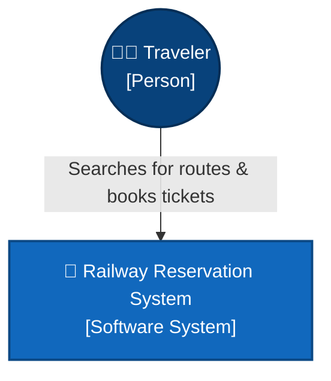
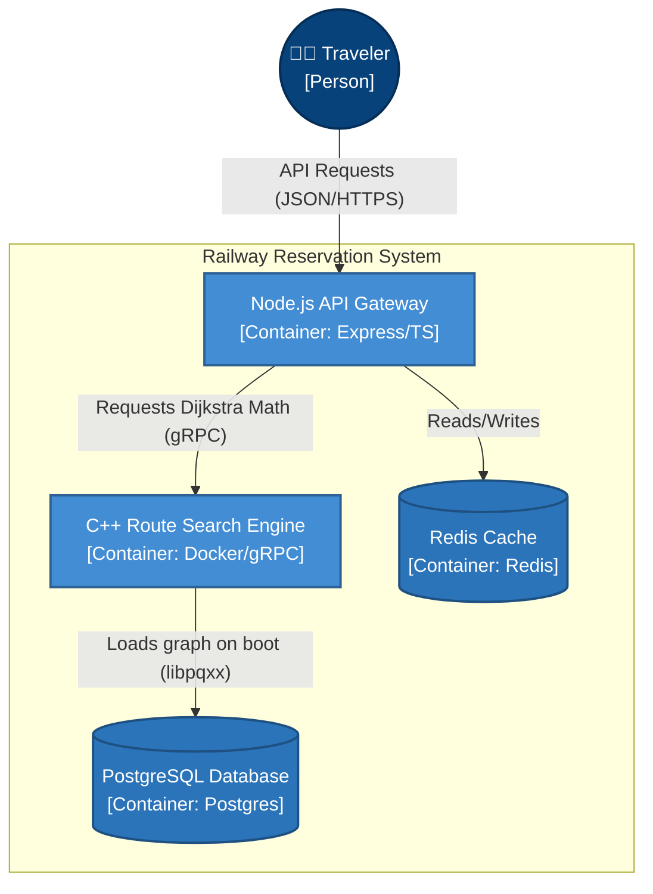
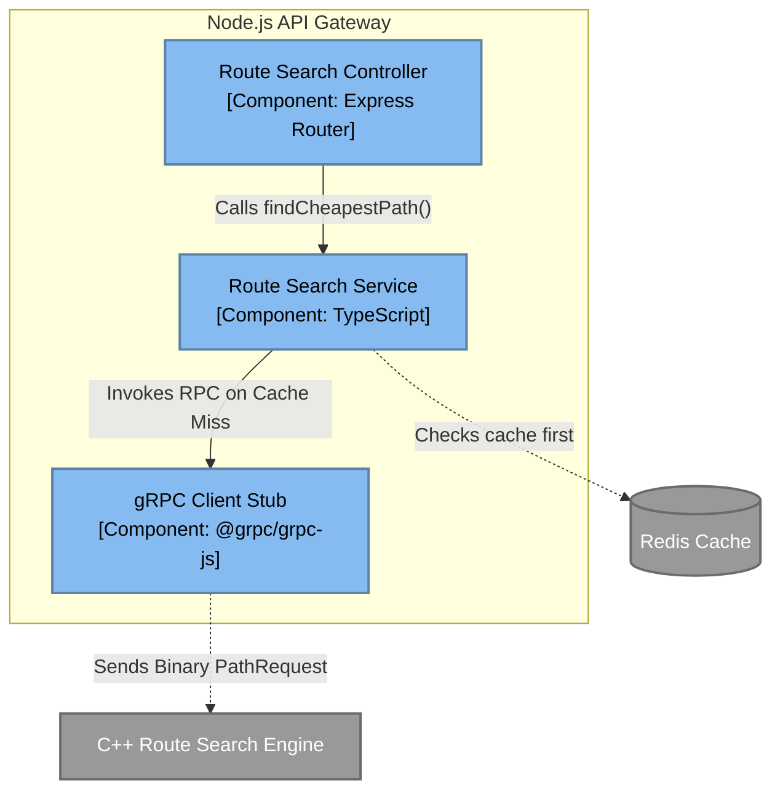

# 🏗️ The C4 Architecture Model

The C4 model is the industry standard for visualizing software architecture. It zooms in like Google Maps: starting from a high-level satellite view (Level 1) and zooming down to the specific code modules (Level 3).

## Level 1: System Context Diagram
*The "Satellite View". Shows how your system interacts with the outside world.*

---

## Level 2: Container Diagram
*The "City View". Unboxes your system to show the high-level applications, databases, and microservices.*

---

## Level 3: Component Diagram (Node.js API Gateway)
*The "Street View". Zooms inside a specific container (Node.js) to show its internal file structure and services.*

